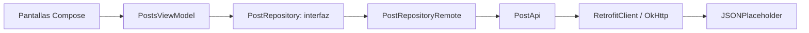
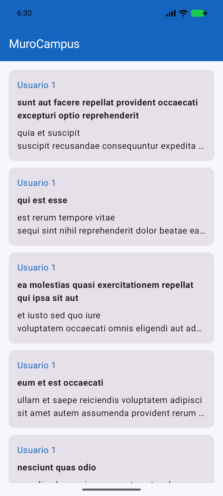
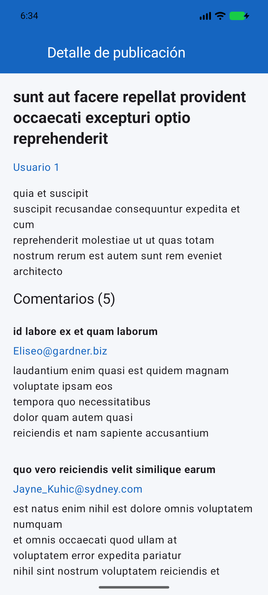
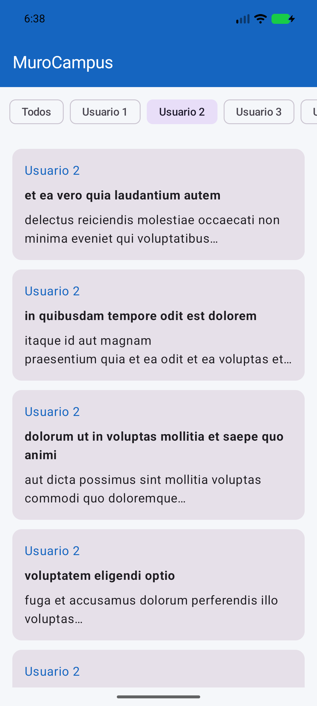
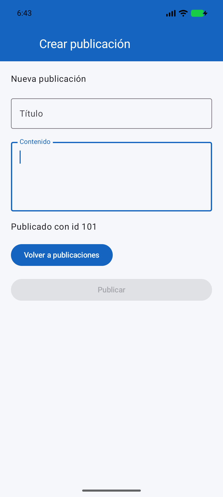
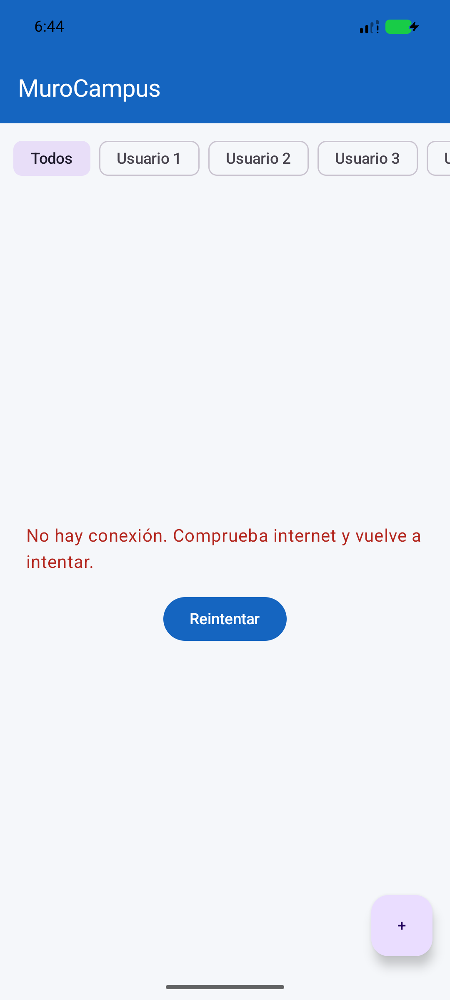

# MuroCampus

**Estudiante:** Jose Contreras Cabrera

**Paquete:** `com.tecsup.murocampus`

Aplicación Android de ejemplo para consultar publicaciones, abrir sus comentarios, filtrar por usuario y enviar una publicación usando la API pública JSONPlaceholder.

## Origen del proyecto

El docente no proporcionó un proyecto base. Por eso, MuroCampus se creó desde cero en la carpeta de entrega. El primer commit conserva el mensaje exigido por la guía, pero no representa la importación de archivos docentes.

## Requisitos y ejecución

- Android Studio con Android SDK instalado.
- JDK 17 o superior. Esta entrega se compiló con Java 21.
- Conexión a internet para descargar dependencias y consultar JSONPlaceholder.
- Emulador o dispositivo Android con API 24 o superior.

Abre la carpeta raíz del repositorio en Android Studio o ejecuta en Windows:

```powershell
.\gradlew.bat :app:assembleDebug
```

El APK de depuración se genera en `app/build/outputs/apk/debug/app-debug.apk`. `local.properties` es local y no forma parte del repositorio.

## Versiones utilizadas

| Herramienta o biblioteca | Versión |
|---|---:|
| JDK usado en las verificaciones | 21.0.12 |
| Gradle Wrapper | 8.13 |
| Android Gradle Plugin | 8.13.0 |
| Kotlin y plugin Compose | 2.2.10 |
| Android SDK compile/target | 36 |
| Android SDK mínimo | 24 |
| Compose BOM | 2025.12.00 |
| Retrofit y converter kotlinx-serialization | 2.11.0 |
| kotlinx-serialization-json | 1.9.0 |
| OkHttp y logging-interceptor | 4.12.0 |
| Lifecycle Runtime/Compose y ViewModel/Compose | 2.9.4 |

AGP 8.13.0 admite Gradle 8.13 y requiere JDK 17 como mínimo. El plugin de Compose usa la misma versión que Kotlin.

## Estructura del código

```text
com.tecsup.murocampus/
├── MainActivity.kt
├── data/
│   ├── ErroresRed.kt
│   ├── PostRepository.kt
│   ├── PostRepositoryRemote.kt
│   ├── UsuarioRepository.kt
│   ├── UsuarioRepositoryRemote.kt
│   └── remote/
│       ├── PostApi.kt
│       └── RetrofitClient.kt
├── model/
│   └── Modelos.kt
├── ui/
│   ├── Componentes.kt
│   ├── PantallaCrear.kt
│   ├── PantallaDetalle.kt
│   ├── PantallaLista.kt
│   └── theme/Theme.kt
└── viewmodel/
    ├── PostsViewModel.kt
    ├── PostsViewModelFactory.kt
    └── UiState.kt
```

## Arquitectura



Las pantallas observan `StateFlow` mediante `collectAsStateWithLifecycle()`. El ViewModel expone estados únicos `Cargando`, `Exito` y `Error`; el Repository encapsula solicitudes suspend y retorna `Result`. El ViewModel recibe una interfaz y no depende de Retrofit ni de `Context`. Las pantallas no llaman al API directamente.

Los Repository convierten errores HTTP, de conectividad y de serialización en `ErrorRepositorio`, que conserva la causa original. La clasificación de `HttpException` y transporte permanece en `data`; el ViewModel traduce los errores propios a mensajes de UI. Así se mantiene `HttpException` fuera de `viewmodel/` y `UiState` sin dependencias de red.

Al cambiar de filtro o detalle se cancela la solicitud anterior y se invalida su identificador; cerrar el detalle cancela también las solicitudes paralelas de publicación y comentarios. Esto evita que una respuesta vieja reemplace el estado vigente.

## Capturas del emulador

Las cinco imágenes son capturas reales tomadas desde el emulador Pixel_6 durante la verificación.

### Lista



### Detalle y comentarios



### Filtro por usuario



### Crear publicación



### Error de conexión



## Verificaciones realizadas

Todas las compilaciones siguientes se ejecutaron con `gradlew.bat :app:assembleDebug`.

| Verificación | Resultado observado |
|---|---|
| Base Compose, instalación y apertura | `BUILD SUCCESSFUL`; Pixel_6 abrió la pantalla inicial con barra azul MuroCampus. |
| Dependencias, permiso INTERNET y conectividad | `BUILD SUCCESSFUL`; el emulador recibió `/posts/1` y JSON válido. |
| Modelos | `BUILD SUCCESSFUL`; propiedades y tipos contrastados con respuestas de posts, comments y users. |
| Interfaces API | `BUILD SUCCESSFUL`; rutas GET/POST, Path, Query y Body revisadas. |
| Cliente Retrofit | `BUILD SUCCESSFUL`; Logcat mostró HTTP 200 y `Llegaron 100 publicaciones`. La prueba temporal se retiró. |
| Repository | `BUILD SUCCESSFUL`; errores propios conservan `cause`, se relanza cancelación y no se encontraron dependencias de UI. |
| Lista y estados | Pixel_6 mostró la lista; Logcat de respuesta contenía 100 publicaciones. Rotar a paisaje conservó la lista. Sin red apareció el error y Reintentar recuperó los datos. |
| Detalle | Publicación 1 mostró texto completo y 5 comentarios. Al volver, la lista permaneció cargada. Sin red se mostró el error y el reintento recuperó el detalle. |
| Filtros | Usuario 2 quedó seleccionado; la solicitud fue `GET /posts?userId=2` con 10 resultados. Todos produjo 100 resultados. |
| Crear publicación | `POST /posts` respondió HTTP 201, `Location: /posts/101` y JSON con id 101. La pantalla mostró el id y limpió los campos. |
| 404 y clasificación | `/posts/9999` respondió 404; la prueba del Repository lo clasificó como `ErrorRepositorio.Http(404)`. |
| Campo adicional | El decoder con `ignoreUnknownKeys = true` aceptó un Post con propiedad adicional. |
| Campo requerido ausente | La deserialización produjo `SerializationException`; el Repository fake la convirtió en `ErrorRepositorio.RespuestaInesperada`. |
| Cancelar al salir del detalle | Repository suspendidos de prueba confirmaron que las dos solicitudes paralelas fueron canceladas al cerrar el detalle (`solicitudes canceladas=2`). La instrumentación se retiró. |
| Auditoría MVVM | No se encontraron llamadas Retrofit en UI, imports de red en ViewModel, `GlobalScope`, `TODO()` ejecutables ni catch vacíos. |

Los casos de serialización y cancelación se verificaron con código temporal de auditoría dentro del emulador; ese código se eliminó antes de preparar la entrega. Los cinco archivos de captura conservados en `capturas/` corresponden a las pantallas reales indicadas.

## Preguntas de la guía

1. **GET frente a POST; `@Body` frente a `@Query`.** GET consulta recursos y parámetros como `@Query("userId")` se agregan a la URL. POST envía datos para crear mediante un cuerpo JSON, que Retrofit serializa desde el parámetro con `@Body`.
2. **Por qué `"posts"` y no `"/posts"`.** La ruta se combina con la base URL, que termina en `/`. Mantener la ruta relativa evita reemplazar accidentalmente el segmento de ruta base y sigue la convención de Retrofit.
3. **Por qué el Repository retorna `Result`.** Permite representar éxito o fallo sin acoplar la capa de datos a la UI; el ViewModel transforma el resultado en el estado observable apropiado.
4. **Sin INTERNET y sin `ignoreUnknownKeys`.** Sin permiso de red Android bloquea la solicitud y la aplicación muestra un error recuperable. Si el JSON incluye claves desconocidas y el decoder no las ignora, la deserialización falla; la capa de datos la comunica como respuesta inesperada. Un campo obligatorio ausente también falla.
5. **`when` con `UiState` frente a variables separadas.** Un estado sellado hace explícito que carga, éxito y error son alternativas excluyentes. Con variables independientes podrían coexistir estados contradictorios, como error y datos de éxito al mismo tiempo.
6. **Backend que persiste POST.** La pantalla y el contrato pueden conservarse, pero el servidor asignaría y almacenaría el registro. Para verlo después en la lista habría que actualizar la consulta o insertar en el estado local, además de definir autenticación, validación y manejo de conflictos que JSONPlaceholder no ofrece.

## Adaptaciones y límites

- La base Android se construyó desde cero porque no existía un proyecto entregado por el docente; el mensaje del primer commit se mantuvo por la rúbrica.
- El usuario de referencia se ubicó en `Modelos.kt`, `UsuarioApi` en `data/remote` y su Repository en `data`, de acuerdo con las etapas en que esas piezas pasan a existir.
- La clasificación de errores permanece en `data` aunque el ejemplo del laboratorio la ubique en ViewModel, porque la auditoría prohíbe que ViewModel conozca `HttpException`.
- Durante la auditoría final se detectó que salir del detalle no cancelaba explícitamente una petición todavía activa. Se añadió y publicó la corrección `fix(detalle): cancela la solicitud al salir`, sin reescribir historial. Por ello el historial tiene un commit correctivo adicional respecto de los 11 pasos previstos.
- JSONPlaceholder simula la creación y responde con id 101, pero no persiste el post. No aparecerá al consultar la lista nuevamente.

## Propuesta de IA y fase 2 (`mejora-ia`)

Esta rama desarrolla el **Asistente Académico de MuroCampus**, una herramienta en español relacionada con las publicaciones. Toma como referencia funciones de participación y descubrimiento de foros comunitarios —por ejemplo, revisar un borrador y mostrar conversaciones relacionadas antes de publicar— como las comprobaciones previas a publicar y las sugerencias de comunidades descritas por [Reddit](https://redditinc.com/news/making-reddit-easier-and-more-productive), sin usar su identidad visual. Los colores se ajustan al azul/celeste y blanco visibles en la [identidad pública de TECSUP](https://www.tecsup.edu.pe/).

La pantalla de detalle permite conversar con el asistente usando esa publicación y sus comentarios como contexto. En el formulario de creación, el estudiante puede pedir una revisión de claridad y buscar hasta tres publicaciones relacionadas antes de decidir si publica. La sugerencia no modifica ni publica el borrador.

La integración usa [Firebase AI Logic](https://firebase.google.com/docs/ai-logic) con el modelo estable `gemini-3.8-flash`; el filtrado local por palabras compartidas reduce la lista de posibles coincidencias y el modelo explica las candidatas con sus números. Ese filtro no es una búsqueda semántica ni reemplaza un índice/vector store. Las instrucciones piden responder en español, priorizar pistas y explicaciones, distinguir el contexto disponible y no repetir los correos de los comentarios. Las respuestas de IA pueden equivocarse; el estudiante debe contrastarlas con el contenido original.

### Configuración para habilitar Gemini

Para mantener la clave del proveedor fuera del APK, la aplicación accede a Gemini a través del SDK y proxy de Firebase AI Logic. El proyecto se conserva compilable sin Firebase configurado; al solicitar una respuesta real se mostrará un mensaje de configuración si falta el proyecto.

1. En Firebase Console, crea un proyecto y registra una app Android con el identificador `com.tecsup.murocampus`.
2. En **AI Logic**, habilita el proveedor Gemini Developer API y completa el asistente de configuración.
3. Descarga `google-services.json` y colócalo en `app/google-services.json`. El archivo está excluido de Git.
4. Compila e instala la variante `debug`. App Check usa el proveedor de depuración solo en debug.
5. En Logcat, busca el token de depuración de App Check y regístralo en Firebase Console para que AI Logic acepte las solicitudes del emulador.
6. Ejecuta la app y consulta una publicación. El texto de la publicación, los comentarios y la consulta se envían a Gemini al usar el asistente; no incluyas datos personales o sensibles.

La configuración Firebase y el registro del token dependen de la cuenta del estudiante. En esta rama se verificó compilación, pero no se declara una respuesta real de Gemini: esta carpeta no tenía `google-services.json` ni un proyecto Firebase asociado durante la implementación.

## Commits y publicación

Cada paso se publicó en `main` tras su commit. La corrección tardía de cancelación también se publicó y se documenta arriba. El historial remoto se debe comparar con `main` al revisar esta entrega.
